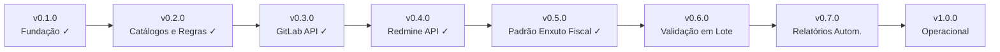

# Roadmap Evolutivo — VERA

Este documento descreve o planejamento evolutivo da skill **VERA (Validação de Evidências e Registros de Atividades)**, desde sua fundação estrutural até a versão operacional completa.

> **Nota de Portabilidade:** A evolução da VERA mantém todos os recursos internos autocontidos na pasta da skill com caminhos estritamente relativos, preservando compatibilidade contínua com versionamento no GitHub e distribuição via `skills.sh`.

---

## Visão Geral das Fases

---

## Detalhamento das Versões

### `v0.1.0` — Fundação *(Concluída)*
- [x] Estrutura inicial de diretórios padronizada, `SKILL.md`, `README.md`, `CHANGELOG.md`, `ROADMAP.md`, `config/*.example.yaml`, `references/` e `.gitignore`.

---

### `v0.2.0` — Catálogos e Regras de Auditoria *(Concluída)*
- [x] `catalogs/catalog.schema.json` e `catalogs/catalogo-atividades.yaml` (31 atividades em 4 sessões).
- [x] Incorporação do **Entendimento Acordado Economia & CAST** sobre operações CRUD e exclusões (`[desconsiderado] — 0 UM`).
- [x] Incorporação da **Regra de `ENUM`** (`1 UM por commit` em `[backend]` e `[backend-alteracao]`).
- [x] Atualização de **`[Suporte]`** (1 UST/chamado único com deduplicação) e **`[Componente]`** (2 UST/arquivo ou componente).
- [x] Criação do template oficial `templates/ust-validation-report.template.md`.

---

### `v0.3.0` — GitLab *(Concluída)*
- [x] Conectores portáveis `scripts/gitlab-connector.ps1` e `scripts/gitlab-connector.sh`.
- [x] Armazenamento seguro em `./config/gitlab.yaml` e onboarding interativo com guia passo a passo (`token-guide`).
- [x] Consultas somente leitura: `test`, `commit` (metadados + diff), `search-task` e `my-commits`.

---

### `v0.4.0` — Redmine *(Concluída)*
- [x] Conector somente leitura via Chave de Acesso API (`redmine.yaml`), onboarding interativo e consulta a tarefas, anexos, journals e horas.
- [x] Auditoria consolidada de demanda-mãe (`-Action demand`) e template `templates/demand-audit-report.template.md`.

---

### `v0.5.0` — Padrão Enxuto Fiscal Edilson *(Versão Atual — Concluída)*

**Objetivo:** Implementar o padrão oficial de notas de evidência enxutas para apontamento de tarefas no Redmine, homologado pela fiscalização de contrato da Economia-GO (fiscal Sr. Edilson).

**Entregas:**
- [x] Padronização estrutural de notas no Redmine: commit, blocos `*Unidade elementar N*` separados por `---`, resumo objetivo do comportamento entregue, caminho do arquivo/classe, método e linhas obrigatórias para alterações.
- [x] Criação do template `templates/redmine-task-note.template.md`.
- [x] Incorporação da regra `lean_task_note_format_rule` em `catalogs/catalogo-atividades.yaml`.
- [x] Atualização de `SKILL.md`, `README.md`, `references/billing-catalogs.md`, `references/redmine.md` e `config/vera.yaml`.
- [x] Conectores portáveis `scripts/redmine-connector.ps1` (PowerShell) e `scripts/redmine-connector.sh` (Bash).
- [x] Verificação automática de `./config/redmine.yaml` (`check-config`) e armazenamento seguro fora do controle de versão (`.gitignore`).
- [x] Fluxo interativo de primeiro uso (*Onboarding*) com opção dedicada para usuários que não sabem como obter a Chave de Acesso API no Redmine (`token-guide`).
- [x] Teste de conectividade e autenticação (`test` -> `GET /users/current.json`).
- [x] Consulta completa de tarefas (`issue`) retornando subtarefas, anexos, comentários (`journals`), apontamentos de horas (`time_entries`) e diagnóstico automático do **Critério Triplo** (`100_PORCENTO_COBRADO_OU_REGULAR` vs. `PENDENTE_DE_HORAS`).
- [x] Listagem de tarefas do usuário (`my-issues`) e consulta de apontamentos de horas (`time-entries`).

---

### `v0.5.0` — Validação

**Objetivo:** Implementar utilitários de cruzamento automatizado em lote entre o que foi declarado no Redmine, o que foi evidenciado no GitLab e o que prevê o catálogo em `catalogs/catalogo-atividades.yaml`.

**Entregas Previstas:**
- [ ] Script orquestrador de validação cruzada integrando a saída de `redmine-connector` e `gitlab-connector`.
- [ ] Auditoria comparativa automatizada Previsto vs. Real em nível de `Categoria + Unidade de Medida (UM)`.
- [ ] Detecção automática de recorrência de métodos/operações entre commits da mesma demanda.

---

### `v0.6.0` — Relatórios

**Objetivo:** Automatizar a geração em lote de relatórios técnicos em Markdown (e exportações auxiliares) a partir dos templates em `templates/`.

**Entregas Previstas:**
- [ ] Adição de templates complementares para relatórios consolidados de sprint/período (`sprint-ust-report.template.md`).
- [ ] Script gerador de relatórios preenchidos a partir dos resultados do módulo de validação.

---

### `v1.0.0` — Versão Operacional

**Objetivo:** Consolidar todos os módulos em um fluxo integrado, resiliente, testado e pronto para distribuição pública.

**Entregas Previstas:**
- [ ] Fluxo de execução integrado ponta a ponta (Redmine + GitLab + Catálogos + Validação + Relatórios).
- [ ] Suíte de testes automatizados (unitários e de integração com mocks).
- [ ] Tratamento robusto de erros, sanitização de dados sensíveis e auditoria de segurança.
- [ ] Empacotamento e publicação final para instalação via `skills.sh`.
