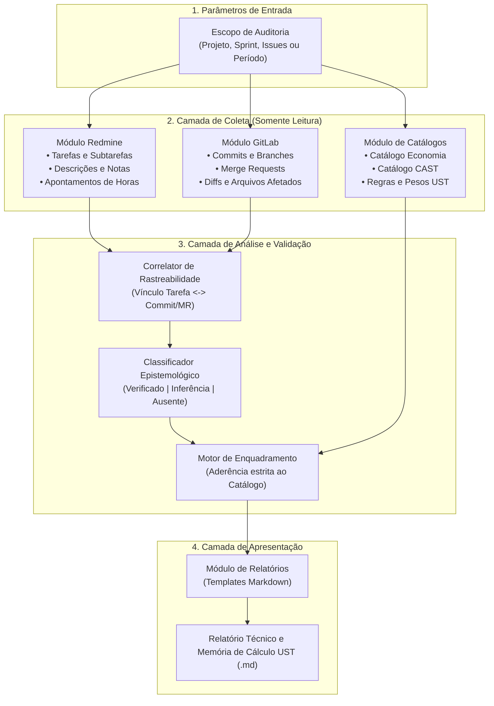

# Arquitetura Conceitual — Skill VERA

> **Status (`v0.1.0`):** Especificação arquitetural de referência. Os módulos descritos abaixo definem responsabilidades planejadas para evolução incremental conforme o [`ROADMAP.md`](../ROADMAP.md).

---

## 1. Visão Geral e Princípios de Design

A arquitetura da **VERA (Validação de Evidências e Registros de Atividades)** foi concebida para ser **modular, extensível, auditável e agnóstica de agente de IA**, aderindo à especificação `SKILL.md`.

### Princípios Arquiteturais

1. **Separação Estrita de Responsabilidades (SoC):** Coleta de registros funcionais (Redmine), extração de evidências técnicas (GitLab), interpretação de catálogos (Economia/CAST), motor de validação e formatação de relatórios residem em domínios independentes.
2. **Baixo Acoplamento:** Uma mudança na estrutura da API do Redmine ou na versão do catálogo da Economia não exige reescrita do extrator do GitLab nem do gerador de relatórios.
3. **Imutabilidade das Fontes (*Read-Only by Design*):** A arquitetura opera exclusivamente como consumidora de dados das ferramentas de gestão e controle de versão.
4. **Rastreabilidade Determinística:** Nenhum valor de UST ou código de catálogo deve emergir de uma "caixa-preta". Cada conclusão do módulo de validação precisa apontar para:
   - O ID da tarefa no Redmine;
   - O(s) hash(es) de commit ou Merge Request no GitLab;
   - A regra explícita do catálogo utilizado.
5. **Rigor Epistemológico:** O modelo de dados diferencia estruturalmente *fatos verificados*, *inferências* e *lacunas de informação*.

---

## 2. Diagrama de Componentes e Fluxo de Dados

---

## 3. Responsabilidades Planejadas por Módulo

### 3.1. Módulo Redmine (`v0.4.0`)
- Consultar tarefas (*issues*), subtarefas e relacionamentos.
- Extrair descrições funcionais, critérios de aceitação, notas de histórico (*journals*) e apontamentos (*time entries*).
- Identificar e filtrar tarefas elegíveis relacionadas ao desenvolvimento e manutenção de software.
- **Referência detalhada:** [`references/redmine.md`](./redmine.md)

### 3.2. Módulo GitLab (`v0.3.0`)
- Consultar repositórios, branches, commits e merge requests no período ou escopo analisado.
- Extrair metadados de autoria, timestamps, mensagens de commit e referências cruzadas.
- Analisar *diffs* entre versões para identificar o tipo e a extensão técnica das modificações realizadas.
- **Referência detalhada:** [`references/gitlab.md`](./gitlab.md)

### 3.3. Módulo de Catálogos (`v0.2.0`)
- Carregar e validar schemas estruturados dos catálogos **Economia** e **CAST**.
- Disponibilizar códigos de serviço, descrições normativas, entregáveis obrigatórios, critérios de complexidade e valores de UST.
- Impedir o uso de códigos inexistentes ou regras não documentadas.
- **Referência detalhada:** [`references/billing-catalogs.md`](./billing-catalogs.md)

### 3.4. Módulo de Validação (`v0.5.0`)
- Cruzar as tarefas do Redmine com as evidências técnicas do GitLab.
- Classificar cada relação segundo os três níveis de certeza:
  1. **Evidência Verificada:** Vínculo explícito (ex.: issue `#1234` citada no commit/MR) e código compatível com a descrição da tarefa.
  2. **Inferência Técnica:** Ausência de vínculo explícito na mensagem de commit, mas forte correlação temporal, autoral e semântica nos arquivos alterados.
  3. **Informação Ausente:** Tarefa sem commits/evidências localizadas, ou commit sem tarefa correspondente, ou ausência de artefato exigido pelo catálogo.
- Propor o enquadramento técnico no catálogo com justificativa analítica e apontar eventuais inconsistências.

### 3.5. Módulo de Relatórios (`v0.6.0`)
- Receber o resultado estruturado do Módulo de Validação.
- Aplicar os modelos definidos em `templates/` para gerar documentos Markdown legíveis e padronizados.
- Consolidar quadros-resumo de atividades, evidências técnicas, códigos de catálogo, quantidades de UST justificadas e lista de pendências.

---

## 4. Diretrizes de Segurança e Fronteiras do Sistema

| Aspecto | Regra Arquitetural |
| :--- | :--- |
| **Permissões de API** | Apenas métodos `GET` (ou consultas `query` em GraphQL). Operações de escrita (`POST`, `PUT`, `PATCH`, `DELETE`) nas APIs de origem são bloqueadas por design. |
| **Gestão de Segredos** | Nenhuma chave ou token é lido de arquivos rastreados pelo Git. A injeção ocorre via variáveis de ambiente em tempo de execução. |
| **Integridade Normativa** | O módulo de validação somente referencia itens presentes nos arquivos de catálogo ativos em `catalogs/`. Caso nenhum item se aplique, reporta como `NAO_ENQUADRADO` / `INFORMACAO_AUSENTE`. |
