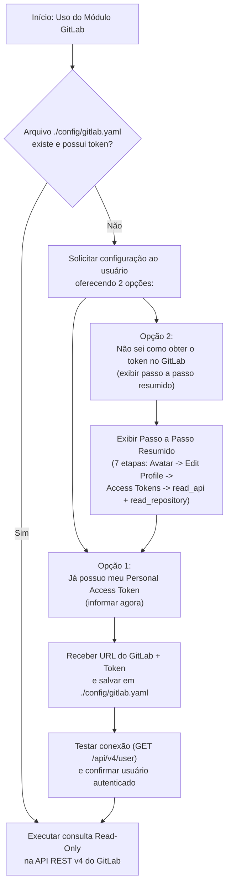

# Especificação Técnica e Integração — Módulo Git / GitLab

> **Status (`v0.3.0`):** Integração somente leitura via Personal Access Token (PAT) implementada em [`../scripts/gitlab-connector.ps1`](../scripts/gitlab-connector.ps1) (Windows/PowerShell) e [`../scripts/gitlab-connector.sh`](../scripts/gitlab-connector.sh) (Linux/macOS/Bash), com armazenamento local não versionado em `./config/gitlab.yaml` e fluxo interativo de primeiro acesso.

---

## 1. Arquitetura de Autenticação via Personal Access Token (PAT)

A integração da **VERA** com o GitLab utiliza a **API REST v4** autenticada por meio de um **Personal Access Token (PAT)** enviado no cabeçalho HTTP `PRIVATE-TOKEN`.

### Características de Segurança e Portabilidade
1. **Arquivo Local Não Versionado (`./config/gitlab.yaml`):**
   - A chave de acesso (`personal_access_token`) e a URL da instância (`base_url`) ficam armazenadas exclusivamente no arquivo `./config/gitlab.yaml`.
   - Este arquivo está explicitamente listado no [`.gitignore`](../.gitignore), garantindo que o token **jamais** seja commitado no GitHub ou publicado no `skills.sh`.
   - Apenas o arquivo modelo [`../config/gitlab.example.yaml`](../config/gitlab.example.yaml) (sem credenciais) é versionado.
2. **Escopo Estritamente Somente Leitura (`read_only`):**
   - O token deve ser gerado apenas com os escopos **`read_api`** e **`read_repository`**.
   - O conector realiza exclusivamente requisições HTTP `GET`.

---

## 2. Fluxo Obrigatório de Primeiro Uso (*Onboarding Interativo*)

Sempre que a skill VERA for acionada para consultar o GitLab, o agente (ou o script conector) deve seguir este protocolo de verificação:



### Passo a Passo Resumido para Obter o Token no GitLab
*(Exibido ao usuário sempre que ele escolher a opção "Não sei como obter o token")*

1. Acesse o GitLab da sua organização no navegador e faça login.
2. No canto superior esquerdo (ou direito), clique no seu **Avatar (Foto de Perfil)** e selecione **Edit profile** (*Editar perfil*) ou **Preferences** (*Preferências*).
3. No menu lateral esquerdo, clique em **Access Tokens** (*Tokens de Acesso*) ou **Personal access tokens**.
4. Clique no botão **Add new token** (*Adicionar novo token*).
5. Preencha os dados do token:
   - **Token name (Nome):** `VERA-Skill-ReadOnly`
   - **Expiration date (Expiração):** Escolha uma data futura (ou deixe em branco, se permitido).
   - **Select scopes (Escopos — marque apenas estes dois de leitura):**
     - `[x] read_api` *(Permite consultar a API do GitLab em modo leitura)*
     - `[x] read_repository` *(Permite ler commits, branches e diffs)*
6. Clique em **Create personal access token** (*Criar token de acesso pessoal*).
7. **Copie o token gerado imediatamente** (por segurança, o GitLab só exibe o valor na tela uma única vez).

---

## 3. Comandos do Conector GitLab (`scripts/gitlab-connector`)

Os conectores utilizam apenas caminhos relativos à própria skill:

### 3.1. Verificar se a Configuração e o Token Existem (`check-config`)
```powershell
powershell -ExecutionPolicy Bypass -File ./scripts/gitlab-connector.ps1 -Action check-config
```
Retorna JSON indicando `"status": "READY"` ou `"status": "ONBOARDING_REQUIRED"` (nunca expõe o token).

### 3.2. Exibir o Passo a Passo de Obtenção do Token (`token-guide`)
```powershell
powershell -ExecutionPolicy Bypass -File ./scripts/gitlab-connector.ps1 -Action token-guide
```

### 3.3. Configurar ou Atualizar o Token (`setup`)
- **Modo Interativo no Terminal** (pergunta se já possui o token ou se deseja ver o passo a passo):
  ```powershell
  powershell -ExecutionPolicy Bypass -File ./scripts/gitlab-connector.ps1 -Action setup
  ```
- **Modo Parametrizado (usado pela LLM após coletar a resposta do usuário):**
  ```powershell
  powershell -ExecutionPolicy Bypass -File ./scripts/gitlab-connector.ps1 -Action setup -BaseUrl "https://gitlab.sua-org.gov.br" -Token "glpat-xxxx" -DefaultProject "grupo/projeto"
  ```

### 3.4. Testar a Conexão com o GitLab (`test`)
```powershell
powershell -ExecutionPolicy Bypass -File ./scripts/gitlab-connector.ps1 -Action test
```
Consulta `GET /api/v4/user` e retorna os dados do usuário autenticado (`id`, `username`, `name`, `state`, `web_url`).

### 3.5. Consultar Commit e Diff (`commit`)
```powershell
powershell -ExecutionPolicy Bypass -File ./scripts/gitlab-connector.ps1 -Action commit -Project "grupo/projeto" -Sha "a1b2c3d4"
```

### 3.6. Buscar Branches e Commits de uma Tarefa do Redmine (`search-task`)
```powershell
powershell -ExecutionPolicy Bypass -File ./scripts/gitlab-connector.ps1 -Action search-task -Project "grupo/projeto" -TaskId "193554"
```

### 3.7. Listar Commits do Usuário Autenticado (`my-commits`)
```powershell
powershell -ExecutionPolicy Bypass -File ./scripts/gitlab-connector.ps1 -Action my-commits -Project "grupo/projeto" -Since "2026-10-01"
```

---

## 4. Procedimento Seguro de Coleta de Diffs Locais (Repositório Clonado)

Quando a validação também envolver um repositório Git local:
- **Alterações locais não preparadas:** `git diff --no-ext-diff --find-renames`
- **Alterações *staged*:** `git diff --cached --no-ext-diff --find-renames`
- **Comparação com branch base:** `git diff --no-ext-diff --find-renames BASE...HEAD`
- **Inspeção de commit específico:** `git show --format=fuller --find-renames <HASH>`
- **Mapeamento de arquivos e linhas:** `git diff --name-status ...` e `git diff --unified=0 ...`

---

## 5. Regras de Análise de Código e Prevenção de Dupla Contagem

1. **Prevenção de Duplicidade entre Camadas:** Métodos em `Controller`, `Service` e `DAO/Repository` que apenas delegam a chamada para outra camada não são contados separadamente.
2. **Deduplicação de Múltiplos Hunks:** Múltiplas alterações dentro da mesma operação/método ou mesmo arquivo contam como **1 única UM**.
3. **Regra de `ENUM` (`1 UM por Commit`):** Em `[backend]` e `[backend-alteracao]`, se houver 1 ou 10 `enums` criados/alterados no mesmo commit, contabiliza-se **somente 1 UM por commit**.
4. **Detecção de Recorrência na Mesma Demanda:** Exige confirmação do usuário e justificativa técnica concisa baseada no `git diff` antes de cobrar novamente a mesma operação/método na mesma demanda.
