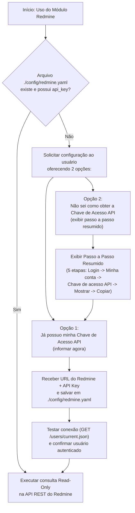

# Especificação Técnica e Integração — Módulo Redmine

> **Status (`v0.4.0`):** Integração somente leitura via Chave de Acesso API (`X-Redmine-API-Key`) implementada em [`../scripts/redmine-connector.ps1`](../scripts/redmine-connector.ps1) (Windows/PowerShell) e [`../scripts/redmine-connector.sh`](../scripts/redmine-connector.sh) (Linux/macOS/Bash), com armazenamento local não versionado em `./config/redmine.yaml` e fluxo interativo de primeiro acesso.

---

## 1. Arquitetura de Autenticação via Chave de Acesso API (`API Key`)

A integração da **VERA** com o Redmine utiliza a **API REST nativa (`.json`)** autenticada por meio da **Chave de Acesso API (`API Key`)** enviada no cabeçalho HTTP `X-Redmine-API-Key`.

### Características de Segurança e Portabilidade
1. **Arquivo Local Não Versionado (`./config/redmine.yaml`):**
   - A chave de acesso (`api_key`) e a URL da instância (`base_url`) ficam armazenadas exclusivamente no arquivo `./config/redmine.yaml`.
   - Este arquivo está explicitamente listado no [`.gitignore`](../.gitignore), garantindo que a chave **jamais** seja commitada no GitHub ou publicada no `skills.sh`.
   - Apenas o arquivo modelo [`../config/redmine.example.yaml`](../config/redmine.example.yaml) (sem credenciais) é versionado.
2. **Modo Estritamente Somente Leitura (`read_only`):**
   - O conector realiza exclusivamente requisições HTTP `GET`. Nenhuma tarefa, nota ou apontamento de horas é criado ou editado.

---

## 2. Fluxo Obrigatório de Primeiro Uso (*Onboarding Interativo*)

Sempre que a skill VERA for acionada para consultar o Redmine, o agente (ou o script conector) segue este protocolo de verificação:



### Passo a Passo Resumido para Obter a Chave de Acesso API no Redmine
*(Exibido ao usuário sempre que ele escolher a opção "Não sei como obter a Chave de Acesso API")*

1. **Acesse o Redmine** da sua organização no navegador e faça login.
2. No canto superior direito da tela, clique em **Minha conta** (*My account*).
3. Na coluna lateral direita da página, localize a seção **Chave de acesso API** (*API access key*).
4. Clique no link **Mostrar** (*Show*) para exibir sua chave *(observação: caso ainda não tenha uma chave gerada, clique em **Redefinir** / **Reset**)*.
5. **Copie a chave alfanumérica exibida** (40 caracteres hexadecimais).

---

## 3. Comandos do Conector Redmine (`scripts/redmine-connector`)

### 3.1. Verificar se a Configuração e a Chave Existem (`check-config`)
```powershell
powershell -ExecutionPolicy Bypass -File ./scripts/redmine-connector.ps1 -Action check-config
```
Retorna JSON indicando `"status": "READY"` ou `"status": "ONBOARDING_REQUIRED"` (nunca expõe a chave).

### 3.2. Exibir o Passo a Passo de Obtenção da Chave (`token-guide`)
```powershell
powershell -ExecutionPolicy Bypass -File ./scripts/redmine-connector.ps1 -Action token-guide
```

### 3.3. Configurar ou Atualizar a Chave (`setup`)
- **Modo Interativo no Terminal:**
  ```powershell
  powershell -ExecutionPolicy Bypass -File ./scripts/redmine-connector.ps1 -Action setup
  ```
- **Modo Parametrizado (usado pela LLM após coletar a resposta do usuário):**
  ```powershell
  powershell -ExecutionPolicy Bypass -File ./scripts/redmine-connector.ps1 -Action setup -BaseUrl "https://gestaoprojetosti.economia.go.gov.br" -ApiKey "SUA_API_KEY"
  ```

### 3.4. Testar a Conexão com o Redmine (`test`)
```powershell
powershell -ExecutionPolicy Bypass -File ./scripts/redmine-connector.ps1 -Action test
```
Consulta `GET /users/current.json` e retorna os dados do usuário autenticado (`id`, `login`, `full_name`, `mail`).

### 3.5. Consultar Tarefa Completa com Auditoria do Critério Triplo (`issue`)
```powershell
powershell -ExecutionPolicy Bypass -File ./scripts/redmine-connector.ps1 -Action issue -IssueId "193554"
```
Retorna os metadados da issue, campos personalizados do catálogo, subtarefas (`children`), anexos (`attachments`), comentários (`journals_with_notes`), apontamentos de horas (`time_entries`) e já classifica o `audit_state` (`100_PORCENTO_COBRADO_OU_REGULAR`, `PENDENTE_DE_HORAS` ou `EM_ANDAMENTO`).

### 3.6. Listar Tarefas Atribuídas ao Usuário Autenticado (`my-issues`)
```powershell
powershell -ExecutionPolicy Bypass -File ./scripts/redmine-connector.ps1 -Action my-issues
```

### 3.7. Consultar Apontamentos de Horas (`time-entries`)
```powershell
# Por tarefa:
powershell -ExecutionPolicy Bypass -File ./scripts/redmine-connector.ps1 -Action time-entries -IssueId "193554"

# Do usuário autenticado em um período:
powershell -ExecutionPolicy Bypass -File ./scripts/redmine-connector.ps1 -Action time-entries -From "2026-10-01" -To "2026-10-29"
```

---

## 4. Critério Triplo de Tarefa "100% Cobrada / Regular"

Na auditoria de tarefas registradas no Redmine, uma tarefa só é classificada como **`🟢 100% COBRADA / REGULAR`** quando atende **cumulativamente** aos 3 requisitos:
1. **Status Concluído / Em Validação:** `Fechada`, `Resolvida`, `Validação` ou `Validação com Ressalvas` (ou `% Concluído = 100%`).
2. **Evidência Técnica / Entregável Vinculado:** Comentário formal contendo hash/link do commit do GitLab (para código) ou anexo obrigatório exigido pelo catálogo.
3. **Horas Lançadas (`spent_hours > 0`):** Se estiver fechada/em validação com `0.0h` lançadas, é classificada automaticamente como **`⚠️ PENDENTE DE HORAS`**.

---

## 5. Regra de Confronto Estrito: `Categoria + Unidade de Medida (UM)`

No confronto entre o faturamento **previsto** (GitLab) e o **real** (Redmine), a comparação ocorre estritamente por `Categoria (tag) + Quantidade de Unidades de Medida (UM)`, apontando **Disparidade** sempre que a categoria ou a quantidade de UMs divergir, mesmo quando o somatório total de UST coincidir.

---

## 6. Padrão Oficial de Notas Enxutas de Lançamento (Orientação Fiscal Sr. Edilson)

Conforme alinhamento com a fiscalização de contrato da Economia-GO (fiscal Sr. Edilson), as notas de evidências registradas nas tarefas do Redmine devem ser mantidas **o mais enxutas possível**:

- **Atividades de Inclusão (`[backend]`, `[frontend]`):**
  - Informar `*Commit*: <url>`, `*Unidade elementar N*`, `*Comportamento entregue*: <resumo>`, `*Arquivo*: <caminho>` e `*Método*: <metodo>`.
  - Número de linha não é obrigatório para inclusões completas.
- **Atividades de Alteração (`[backend-alteracao]`, `[frontend-alteracao]`):**
  - Informar obrigatoriamente as linhas afetadas: `*Linhas*: X a Y`.
- **Separador:**
  - Cada unidade elementar deve ser separada por `---`.
- **Template:**
  - Arquivo base: [`../templates/redmine-task-note.template.md`](../templates/redmine-task-note.template.md).

---

## 7. Padrão Obrigatório de Atividade em Lançamentos de Horas (`Desenvolvimento`)

Em todos os lançamentos de tempo gasto / apontamentos de horas (`time_entries`) em tarefas ou atividades do Redmine:
- O campo **`Atividade`** deve ser preenchido **obrigatoriamente** com o valor **`Desenvolvimento`** (`id: 9`).
- Este é o padrão contratual e operacional definitivo adotado no projeto.
- Nas solicitações do usuário em que a atividade for omitida, a VERA e o assistente devem aplicar automaticamente **`Desenvolvimento`** (`activity_id: 9`).

---

## 8. Modelo Padrão de Criação de Tarefas de [Script]

Para comandos no formato *"crie uma nova tarefa de elaboração de script na demanda ####, use o script a seguir..."*:

1. **Vínculo com Demanda-Mãe:**
   - Obter a demanda pelo `ID` fornecido e vinculá-la como `parent_issue_id`.
   - Herdar o `project_id` e o módulo do sistema (`custom_fields[id=63]`) da demanda-mãe.
2. **Definição de Tipagem e Título:**
   - **Tipo (Tracker):** `Implementação` (`id: 21`).
   - **Título:** Deve obrigatoriamente iniciar com `[Script] - `, seguido de título contextual sintetizado a partir do objetivo do código SQL (ex.: `[Script] - Elaboração de script para atualização da tabela <NOME> em produção`). Caso haja ambiguidade, propor ou perguntar ao usuário.
3. **Campos do Catálogo Cast 13/2024:**
   - **Catálogo (Cast - 13/2024) (`id: 102`):** `DESENVOLVIMENTO E IMPLANTAÇÃO [script]`.
   - **Unid. Medida (Cast) (`id: 29`):** `1` (ou 1 UST a cada bloco de 4 tabelas manipuladas, default 1).
   - **Complexidade Altíssima (`id: 104`):** `Não`.
4. **Campos Gerais:**
   - **Situação:** `Em andamento` (`id: 2`).
   - **Atribuído para:** Usuário logado (`Albino Moreira dos Santos`, `id: 185`).
   - **Descrição inicial da tarefa:** Deixar vazia.
5. **Registro nas Notas (`notes`):**
   - Utilizar o template oficial [`../templates/redmine-script-note.template.md`](../templates/redmine-script-note.template.md).
   - Inserir breve resumo da finalidade e das tabelas/colunas afetadas.
   - Encapsular o script SQL com a notação de código do Redmine:
     ```text
     <pre><code class="sql">
     [código SQL]
     </code></pre>
     ```
6. **Lançamento de Horas (se solicitado):**
   - Preencher as horas informadas com a atividade padrão obrigatória `Desenvolvimento` (`id: 9`).

---

## 9. Modelo Padrão de Lançamento de [Deploy]

Para registro cumulativo de deploys em tarefas de deploy (ex.: tarefas periódicas com catálogo `DESENVOLVIMENTO E IMPLANTAÇÃO [deploy] - atendimento comum`):

1. **Conferência Prévia de Consistência:**
   - Conferir o total de notas/journals e anexos existentes na tarefa contra o valor do campo personalizado `Unid. Medida (Cast)` (`id: 29`).
   - Se houver `N` deploys registrados, o campo deve refletir `N` U.M.
2. **Atualização da Unidade de Medida:**
   - Cada novo deploy adiciona exatamente `+1` U.M. ao campo `Unid. Medida (Cast)` (`nova_UM = UM_atual + 1`).
3. **Anexo e Nota Padronizada:**
   - Utilizar o template oficial [`../templates/redmine-deploy-note.template.md`](../templates/redmine-deploy-note.template.md).
   - Anexar o print comprobatório da execução do pipeline do GitLab via API de uploads (`POST /uploads.json`).
   - Inserir a imagem inline na nota com notação Textile: `!<nome_do_arquivo>!`.
   - Incluir link completo do commit de merge e link do pipeline de deploy.
4. **Lançamento de Horas:**
   - Para cada deploy, lançar `0.5h` (30 minutos) na data de execução com a atividade padrão `Desenvolvimento` (`id: 9`).
